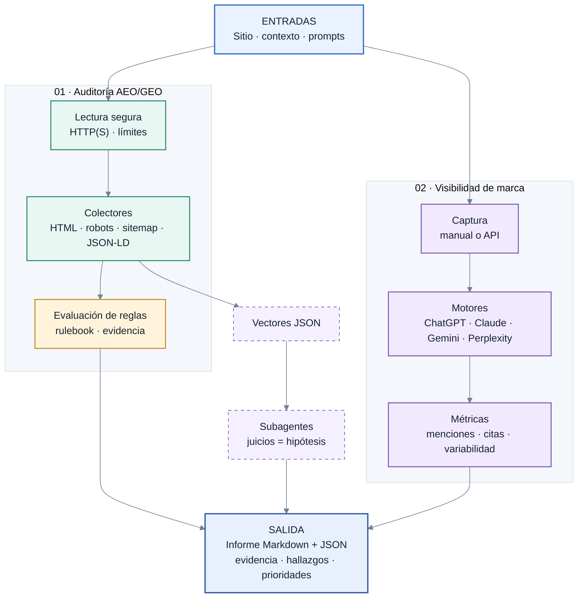

<div align="center">
  <h1>AEO/GEO Auditor</h1>
  <p><strong>Auditoría técnica y medición de visibilidad en buscadores y motores de respuesta con IA.</strong><br>Reúne evidencia observable, reglas con fuentes y métricas reproducibles para ayudar a equipos de SEO, contenido y marketing a priorizar mejoras.</p>
  <p><strong>Alcance:</strong> audita AEO/GEO; no genera ni atribuye MQL, no integra un CRM ni calcula pipeline o ingresos.</p>
  <p>
    <a href="LICENSE"></a>
    <a href="https://www.python.org/"></a>
    <a href="https://github.com/topics/aeo"></a>
    <a href="https://github.com/nabolom/geo-mql-auditor/stargazers"></a>
  </p>
</div>

## Qué es

AEO/GEO Auditor es un skill para Claude Code y un conjunto de herramientas Python para revisar sitios web desde dos perspectivas complementarias:

1. **Audit técnico y de contenido:** recopila señales del sitio y las evalúa contra un rulebook de 73 reglas con evidencia, fuerza y fuentes identificables.
2. **Visibilidad de marca:** organiza capturas manuales o por API en un panel repetible y mide menciones, citas y share of voice, sin mezclar series que no son comparables.

Los colectores reportan lo que observaron; los juicios de subagentes se etiquetan como **Hipótesis**. La herramienta genera informes, pero no modifica el sitio auditado.

## Qué ayuda a resolver

- ¿Qué información técnica y estructurada puede leer un crawler del sitio?
- ¿Hay señales de problemas en `robots.txt`, sitemap, metadatos, JSON-LD, frescura o extractabilidad?
- ¿En qué prompts y motores aparece una marca, y qué fuentes propias se citan?
- ¿La variación entre respuestas o entre corridas permite una comparación razonable?
- ¿Qué hallazgos conviene priorizar según impacto esperado, esfuerzo, dependencia y horizonte, sin inventar un pronóstico de resultados?

## Cómo funciona



### Componentes disponibles

| Componente | Qué hace | Estado |
|---|---|---|
| `contexto` | Valida el contexto del negocio y señala información crítica faltante. | CLI funcional |
| `audit` | Revisa URLs o un sitemap; ejecuta colectores, reglas y genera informes y vectores. | CLI funcional |
| `visibilidad` | Prepara prompts y capturas; analiza respuestas y calcula métricas y calibración manual/API. | CLI funcional |
| `mql` | Generación, scoring o atribución de leads e integración con CRM. | **No implementado**; hay reglas M-01 a M-08, sin colector ni CLI. |
| `compare`, `fix`, `monitor` | Comparación competitiva integral, aplicación de cambios y monitoreo continuo. | **No implementados** como módulos. |

Hay cinco subagentes para los vectores técnico, schema, extractabilidad, entidad y visibilidad. Sus juicios no se presentan como observaciones deterministas.

## Inicio rápido

### Requisitos

- Python **3.11 o posterior**.
- Claude Code para activar el skill y los subagentes.
- `Playwright` y Chromium son opcionales; solo se necesitan para usar `--render`.
- Las llamadas API de visibilidad son opcionales y requieren las credenciales correspondientes.

### Preparar el entorno

Desde la raíz del repositorio:

```bash
python3 -m venv .venv
.venv/bin/python -m pip install -r requirements-dev.txt
cp contexto/negocio.plantilla.md contexto/negocio.md
```

Completa `contexto/negocio.md`. No guardes credenciales en Git. Para modo API, copia `.env.example` a `.env` y agrega únicamente las llaves que vayas a usar; el archivo `.env` no debe publicarse.

### Ejecutar una auditoría

```bash
A=.claude/skills/geo-mql-auditor/scripts/audit.py
.venv/bin/python "$A" correr --url https://dominio.com/
# O bien, audita una muestra de un sitemap:
.venv/bin/python "$A" correr --sitemap https://dominio.com/sitemap.xml --max-urls 100
```

El informe se guarda en `salidas/`; los vectores y archivos de corrida, en `salidas/tmp/`. La herramienta hace lecturas del sitio y no publica cambios en él.

### Medir visibilidad

```bash
V=.claude/skills/geo-mql-auditor/scripts/visibilidad.py
.venv/bin/python "$V" prompts
.venv/bin/python "$V" config
.venv/bin/python "$V" captura --corrida m1 --repeticiones 3
# Completa la hoja generada y luego analiza las respuestas:
.venv/bin/python "$V" analizar --respuestas datos/visibilidad/respuestas_<fecha>_m1.csv
.venv/bin/python "$V" metricas --corrida m1
```

Para una consulta API, revisa primero la estimación disponible:

```bash
.venv/bin/python "$V" correr --corrida a1 --solo-costo
```

El costo máximo puede ser **desconocido** si la tarifa no está publicada o si la petición no limita el número de búsquedas. Los tokens también se cobran aparte. `AI Overviews` solo admite captura manual; las series manual y API no se mezclan y solo se comparan mediante calibración.

Abre Claude Code desde la raíz del proyecto para que encuentre `.claude/agents/` y `.claude/skills/`.

## Cómo interpretar los resultados

- **Observación:** `Confirmado`, `Probable` o `Hipótesis` describe de dónde viene la evidencia.
- **Regla:** fuerza `A`, `B` o `C` y tipo de evidencia describen qué tan respaldado está el criterio aplicado; son dimensiones distintas.
- **`sin_evidencia` no significa que algo esté bien o mal:** indica que la herramienta no pudo verificarlo con los datos disponibles.
- **Métricas de visibilidad son proxies**, no una garantía de aparecer en respuestas ni una proyección de MQL, ventas o ingresos.
- Los deltas solo se calculan cuando las corridas tienen panel, motores, modelos y datos comparables; las capturas incompletas aceptadas explícitamente no sirven de base comparable.

## Pruebas

```bash
.venv/bin/python -m pytest -q
```

El conjunto utiliza fixtures locales con dominios reservados. Una prueba de regresión se omite si el checkout no contiene snapshots de corridas previas.

## Limitaciones y seguridad

- No garantiza posicionamiento, citas, tráfico, leads ni ventas.
- No genera ni atribuye MQL; no escribe en CRM, CMS, analítica o producción.
- `AI Overviews` requiere captura humana. Las citas opacas `google.com/goto` no se cuentan como citas atribuibles ni como ausencia de cita.
- La detección del tipo de página y algunas señales son heurísticas; revisa evidencia y fuentes antes de actuar.
- La auditoría estática limita esquemas, destinos y tamaño de descarga. El render opcional añade filtrado de solicitudes, pero Chromium no fija las IP resueltas frente a DNS rebinding: no uses `--render` como sandbox para sitios deliberadamente hostiles.
- Los motores cambian. Cada regla registra su fuente y fecha de verificación; vuelve a comprobar la vigencia antes de convertir una recomendación en política.

## Licencia y atribución

Este proyecto se distribuye bajo [MIT](LICENSE). Partes adaptadas de `best-aeo-skill` conservan su aviso y licencia; consulta [NOTICE](NOTICE). El rulebook y las decisiones propias de este proyecto no se atribuyen a ese repositorio de origen.
